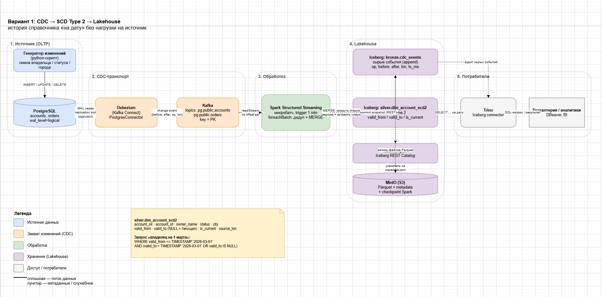

# Отчёт по практической №2

---

## 1. Вариант и задача

| Поле | Значение |
|---|---|
| ФИО (как в VK Education) | Тихонов Дмитрий Вячеславович |
| Тема | 1 — CDC → SCD → Lakehouse |
| Состав решения | PostgreSQL (источник, `wal_level=logical`) → Debezium (Kafka Connect, PostgresConnector) → Kafka → Spark Structured Streaming (микробатч, `foreachBatch` + `MERGE INTO`) → Apache Iceberg (bronze: сырые CDC-события, silver: SCD Type 2) в MinIO, каталог Lakekeeper (Iceberg REST) → Trino → аналитики / бухгалтерия |
| Данные, объем | Учебный справочник счетов `accounts` (id, owner_name, status, city, updated_at) и заказов `orders` (id, account_id, status, amount). Демо-объём: 1 000 счетов, 5 000 заказов; генератор делает одно изменение раз в 3 секунды (смена владельца, переезд, смена статуса, отмена заказа). Масштаб для прода — миллионы строк, десятки тысяч изменений в сутки: архитектура это выдерживает, потому что источник читается только через WAL |

## 2. Источники и способы сбора

| Источник | Тип (поток / batch / CDC / документы в md pdf или другой/ API) | Способ сбора |
|---|---|---|
| PostgreSQL `public.accounts` (справочник счетов: владелец, статус, город) | CDC | Debezium читает WAL через logical replication slot (`pgoutput`). Тяжёлых SELECT к источнику нет — это главное требование задачи. Ловятся все версии строки, включая промежуточные, которые периодической batch-выгрузкой были бы потеряны |
| PostgreSQL `public.orders` (статусы заказов) | CDC | Тот же коннектор, отдельный топик `pg.public.orders`. Нужен для вопроса «какой статус был у заказа до отмены»: в событии Debezium есть `before` и `after` |
| Начальное состояние таблиц | batch (однократно) | `snapshot.mode=initial` у Debezium — один раз при старте выгружает текущее состояние. Это первая версия в SCD2 (`valid_from` = время снапшота). Для больших таблиц — incremental snapshot чанками, чтобы не грузить источник |
| Kafka-топики `pg.public.*` | поток | Spark Structured Streaming `readStream` с хранением offset'ов в checkpoint в docker volume; при рестарте продолжает с того же места, без потерь |

## 3. Архитектура (draw.io безальтернативно)



**Зачем каждый блок:**

- **PostgreSQL** — операционная база, источник правды. Включён `wal_level=logical`, у таблиц `REPLICA IDENTITY FULL`, чтобы в событии было полное `before`.
- **Debezium** — превращает журнал транзакций (WAL) в события изменений `{before, after, op: c/u/d/r, ts_ms, lsn}`. Почему не SELECT по `updated_at`: такой способ нагружает базу, не видит DELETE и пропускает промежуточные изменения между опросами.
- **Kafka** — буфер и журнал событий. Ключ сообщения = первичный ключ, поэтому все изменения одной записи лежат в одной партиции **по порядку**. Если обработка упала, события не теряются: их можно перечитать.
- **Spark Structured Streaming (микробатч)** — выбран вместо непрерывного стриминга, потому что SCD2 = `MERGE` в Iceberg, а каждый коммит Iceberg — это snapshot. Коммитить каждое событие — получится много мелких файлов и snapshot'ов. Микробатч раз в 1 минуту — компромисс между свежестью и количеством файлов. Секундная задержка бухгалтерии не нужна: ей нужна история.
- **Iceberg bronze `cdc_events`** — сырые события как есть. Можно пересобрать silver с нуля и разобрать спорные случаи.
- **Iceberg silver `dim_account_scd2`** и `silver.orders_scd2`** — SCD Type 2: на каждое изменение отслеживаемых атрибутов — новая строка. Поля `valid_from`, `valid_to`, `is_current`, `source_lsn`.
- **MinIO** — S3-совместимое хранилище файлов Parquet и metadata Iceberg.
- **Lakekeeper** — Iceberg REST Catalog: хранит, где лежит текущий `metadata.json` каждой таблицы. Через него Spark и Trino видят одни и те же таблицы.
- **Trino** — SQL-движок для аналитиков, запросы «на дату» к SCD2-таблице без нагрузки на PostgreSQL.

**Выбор типа SCD:**

| Тип | Что делает | Где применимо у меня |
|---|---|---|
| Type 1 | перезапись, без истории | исправление опечаток в ФИО, служебные поля — история не нужна |
| **Type 2** | **новая строка на каждое изменение, интервал действия** | **owner_name, status, city — основной выбор**: нужен ответ «на дату» |
| Type 6 (1+2+3) | Type 2 + колонка «текущее значение» во всех версиях | вариант развития: если аналитики часто спрашивают «исторический заказ, но с *текущим* владельцем» — добавить `current_owner_name` |

## 4. Docker — что поднялось (честно)

| Блок | Статус ( реализовано / нет) |
|---|---|
| PostgreSQL (`wal_level=logical`) | реализовано |
| Kafka (KRaft) | реализовано |
| Kafka Connect + Debezium PostgresConnector | реализовано (коннектор регистрируется автоматически сервисом `connect-init`) |
| Spark Structured Streaming → Iceberg (bronze + SCD2 MERGE) | реализовано (после исправления ошибки, см. ниже) |
| MinIO | реализовано (образ `bitnamilegacy/minio`, см. ниже) |
| Lakekeeper (REST Catalog) + catalog-db | реализовано |
| Trino (Iceberg connector) | реализовано |
| Генератор изменений | реализовано |

Описание действий:

```powershell
# 1. поднять стек 
docker compose up -d
docker ps -a

# 2. проверить, что Spark обрабатывает микробатчи
docker compose logs spark --tail 20

# 3. проверить Debezium и события в Kafka
curl.exe http://localhost:8083/connectors/pg-cdc/status
docker compose exec kafka /opt/kafka/bin/kafka-console-consumer.sh --bootstrap-server kafka:9092 --topic pg.public.accounts --from-beginning --max-messages 2

# 4. изменение в источнике (счёт 1 генератор не трогает)
docker compose exec postgres psql -U app -d app -c "UPDATE accounts SET owner_name='Petrov P.P.' WHERE id=1;"

# 5. через ~1 минуту — история в Trino
docker compose exec trino trino --execute "SELECT account_id, owner_name, city, valid_from, valid_to, is_current FROM iceberg.silver.dim_account_scd2 WHERE account_id = 1 ORDER BY valid_from"

# 6. проверка полноты начального снапшота
docker compose exec trino trino --execute "SELECT 'accounts' AS t, count(DISTINCT account_id) FROM iceberg.silver.dim_account_scd2 UNION ALL SELECT 'orders', count(DISTINCT order_id) FROM iceberg.silver.orders_scd2"
```

Вывод `docker ps`:

```
CONTAINER ID   IMAGE                                    COMMAND                  CREATED      STATUS                         PORTS                                                             NAMES
bc8118beb065   apache/spark:3.5.3                       "/opt/entrypoint.sh …"   3 days ago   Up 28 minutes                                                                                    cdc-scd2-lakehouse-spark-1
4e6bb608e936   trinodb/trino:460                        "/usr/lib/trino/bin/…"   3 days ago   Up About an hour (healthy)     0.0.0.0:8080->8080/tcp, [::]:8080->8080/tcp                       cdc-scd2-lakehouse-trino-1
9d811b57ef1e   curlimages/curl:8.10.1                   "/bin/sh -c 'until c…"   3 days ago   Exited (0) About an hour ago                                                                     cdc-scd2-lakehouse-lakekeeper-init-1
71f0a7e6cf35   curlimages/curl:8.10.1                   "/bin/sh -c 'until c…"   3 days ago   Exited (0) About an hour ago                                                                     cdc-scd2-lakehouse-connect-init-1
b584a1d83521   quay.io/lakekeeper/catalog:latest-main   "/home/nonroot/lakek…"   3 days ago   Up About an hour               0.0.0.0:8181->8181/tcp, [::]:8181->8181/tcp                       cdc-scd2-lakehouse-lakekeeper-1
467259ead413   quay.io/debezium/connect:2.7             "/docker-entrypoint.…"   3 days ago   Up About an hour               0.0.0.0:8083->8083/tcp, [::]:8083->8083/tcp                       cdc-scd2-lakehouse-connect-1
24bc74e63004   python:3.12-slim                         "sh -c 'pip install …"   3 days ago   Up About an hour                                                                                 cdc-scd2-lakehouse-generator-1
0fed5ca6392e   bitnamilegacy/minio:2024.10.13           "/bin/sh -c 'until m…"   3 days ago   Exited (0) About an hour ago                                                                     cdc-scd2-lakehouse-minio-init-1
94b634c15ecf   quay.io/lakekeeper/catalog:latest-main   "/home/nonroot/lakek…"   3 days ago   Exited (0) About an hour ago                                                                     cdc-scd2-lakehouse-lakekeeper-migrate-1
fde62a676f62   postgres:16                              "docker-entrypoint.s…"   3 days ago   Up About an hour (healthy)     0.0.0.0:5433->5432/tcp, [::]:5433->5432/tcp                       cdc-scd2-lakehouse-postgres-1
db014e914d51   postgres:16                              "docker-entrypoint.s…"   3 days ago   Up About an hour (healthy)     5432/tcp                                                          cdc-scd2-lakehouse-catalog-db-1
dc4a0b7bcc48   bitnamilegacy/minio:2024.10.13           "/opt/bitnami/script…"   3 days ago   Up About an hour               0.0.0.0:9000-9001->9000-9001/tcp, [::]:9000-9001->9000-9001/tcp   cdc-scd2-lakehouse-minio-1
19273f6dc1d5   apache/kafka:3.8.0                       "/__cacert_entrypoin…"   3 days ago   Up About an hour               9092/tcp                                                          cdc-scd2-lakehouse-kafka-1
```

Лог Spark — микробатчи раз в минуту, ~20 изменений от генератора в каждом:

```
batch 1: 1325 events processed
batch 2: 7 events processed
batch 3: 15 events processed
batch 4: 20 events processed
...
batch 12: 20 events processed
```

Статус коннектора Debezium:

```
{"name":"pg-cdc","connector":{"state":"RUNNING","worker_id":"172.18.0.8:8083"},"tasks":[{"id":0,"state":"RUNNING","worker_id":"172.18.0.8:8083"}],"type":"source"}
```

Пример CDC-события из Kafka (начальный снапшот, `op: "r"`):

```
{"before":null,"after":{"id":2,"owner_name":"Owner 2","status":"active","city":"Novosibirsk","updated_at":1795366051316950},"source":{"version":"2.7.4.Final","connector":"postgresql","name":"pg","ts_ms":1795366062298,"snapshot":"true","db":"app","schema":"public","table":"accounts","txId":741,"lsn":27600408},"op":"r","ts_ms":1795366062416}
```

Результат SCD2 после `UPDATE accounts SET owner_name='Petrov P.P.' WHERE id=1;`:

```
"1","Owner 1","Kazan","2026-11-22 16:47:42.298000 UTC","2026-11-25 17:04:02.215000 UTC","false"
"1","Petrov P.P.","Kazan","2026-11-25 17:04:02.215000 UTC","","true"
```

Старая версия закрыта (`valid_to` = момент UPDATE, `is_current = false`), новая открыта (`valid_to = NULL`, `is_current = true`). Интервалы стыкуются без разрывов и перекрытий. `valid_from` первой версии — момент начального снапшота Debezium: история начинается с подключения CDC.

Полнота снапшота — в Iceberg столько же записей, сколько в источнике (1000 счетов, 5000 заказов):

```
"orders","5000"
"accounts","1000"
```

Что не поднялось / проблемы и почему:

1. **Не скачивался образ MinIO: `pull access denied for minio/minio`.** В сентябре 2026 MinIO удалила образы `minio/minio` и `minio/mc` с Docker Hub, а с зеркала quay.io они скачиваются только с авторизацией (`401 UNAUTHORIZED`). Решение: перешёл на `bitnamilegacy/minio:2024.10.13` — та же версия MinIO в сборке Bitnami, клиент `mc` есть внутри.
2. **Spark падал и перезапускался: `TABLE_OR_VIEW_NOT_FOUND: bronze_batch`.** Внутри `foreachBatch` Spark выполняет батч в отдельной (клонированной) сессии. Временная таблица регистрировалась в этой сессии, а `MERGE` отправлялся через глобальную `spark`, где её не видно. Решение: все запросы внутри батча выполняются через `batch.sparkSession`. Упавший батч не был зафиксирован в checkpoint, поэтому после перезапуска Spark обработал те же события заново, без потерь — это подтверждает проверка полноты (1000 / 5000).

## 5. Описание

| Шаг | Для чего | Результат |
|---|---|---|
| 1. Приложение / генератор делает `UPDATE accounts SET owner_name=...` | эмуляция реальной работы операционной системы | строка изменена, запись попала в WAL |
| 2. Debezium читает WAL через replication slot | захват изменения без SELECT к таблицам | событие `{op:"u", before:{...}, after:{...}, lsn, ts_ms}` |
| 3. Событие пишется в топик `pg.public.accounts` с ключом `id` | надёжный буфер, порядок изменений одной записи сохраняется | событие лежит в Kafka, его можно перечитать |
| 4. Spark читает микробатч из Kafka | обработка пачкой раз в минуту | DataFrame с новыми событиями, offset'ы в checkpoint |
| 5. MERGE в bronze.cdc_events по (topic, partition, offset) | сырая копия для аудита и пересборки | неизменяемый журнал изменений в Iceberg |
| 6. Дедуп внутри батча по (`id`, `lsn`) и сортировка по `lsn` | повторная доставка не создаёт дублей версий; несколько изменений одной записи в батче применяются по порядку | чистый упорядоченный набор изменений |
| 7. `MERGE INTO silver.dim_account_scd2`: у текущей версии `valid_to = ts_ms`, `is_current=false`; вставка новой версии с `valid_from = ts_ms`. Для `op=d` — только закрытие версии | материализация SCD Type 2. Условие `source_lsn < новый lsn` делает операцию идемпотентной | в таблице полная история записи |
| 8. Commit snapshot Iceberg через Lakekeeper, файлы — в MinIO | атомарная фиксация батча | Trino видит либо весь батч, либо ничего |
| 9. Аналитик в Trino: `WHERE valid_from <= DATE '2026-03-01' AND (valid_to > DATE '2026-03-01' OR valid_to IS NULL)` | ответ «кто был владельцем на 1 марта» | одна строка — владелец на дату |

Важно различать: Iceberg time travel (`FOR TIMESTAMP AS OF`) показывает, **что лежало в таблице** в момент времени (техническая история). SCD2 показывает, **каким был объект в реальности** на дату (бизнес-история). Для бухгалтерии нужен второй вариант, поэтому именно SCD2.

## 6. Выводы

В работе я спроектировал и поднял в Docker систему, которая хранит историю изменений справочника и отвечает на вопросы вида «кто был владельцем счёта на определённую дату». Главное ограничение задачи — тяжёлые SELECT-запросы к рабочей базе запрещены. Поэтому изменения забираются через CDC: Debezium читает журнал транзакций PostgreSQL (WAL) и отправляет события в Kafka. Источник при этом почти не нагружается. Кроме того, CDC видит каждое изменение, включая удаления и промежуточные состояния, которые периодическая выгрузка по updated_at пропустила бы.

Для хранения истории я выбрал SCD Type 2. Type 1 перезаписывает значения, и история пропадает. Type 3 хранит только одно предыдущее значение. Только Type 2 с интервалом valid_from / valid_to позволяет восстановить состояние записи на любую дату. Демонстрация на живом потоке это подтвердила: после UPDATE владельца счёта 1 в Iceberg появились две версии. Старая закрылась ровно в момент изменения, новая стала текущей, интервалы стыкуются без разрывов и перекрытий. Поэтому запрос «на дату» всегда возвращает ровно одну строку.

Обрабатываю данные микробатчами раз в минуту в Spark Structured Streaming, а не непрерывным потоком. Данные пишутся в Iceberg через MERGE, и каждый коммит создаёт новый snapshot. Если писать по одному событию, получится много мелких файлов. Бухгалтерии нужна точная история, а не задержка в секунды, поэтому минутного батча достаточно.

Надёжность проверилась на практике. Из-за ошибки в коде Spark несколько раз падал на одном и том же батче. После исправления он продолжил с последнего зафиксированного offset'а в checkpoint, и проверка полноты показала, что в Iceberg ровно 1000 счетов и 5000 заказов, как в источнике, то есть данные не потерялись. Повторная обработка не создала дублей благодаря двум мерам: дедупликации по lsn и условию source_lsn > текущей версии в MERGE.

## Мой любимый десерт

**Торт наполеон**
